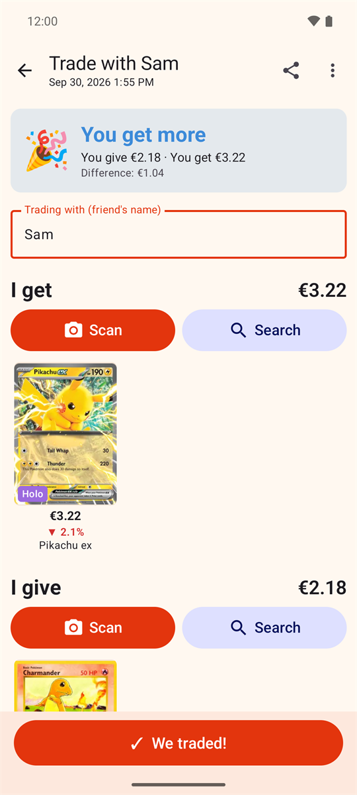
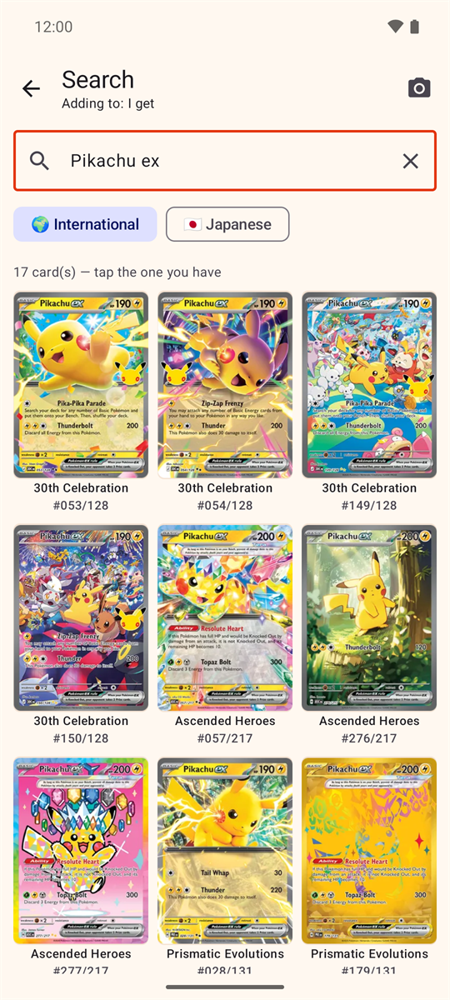
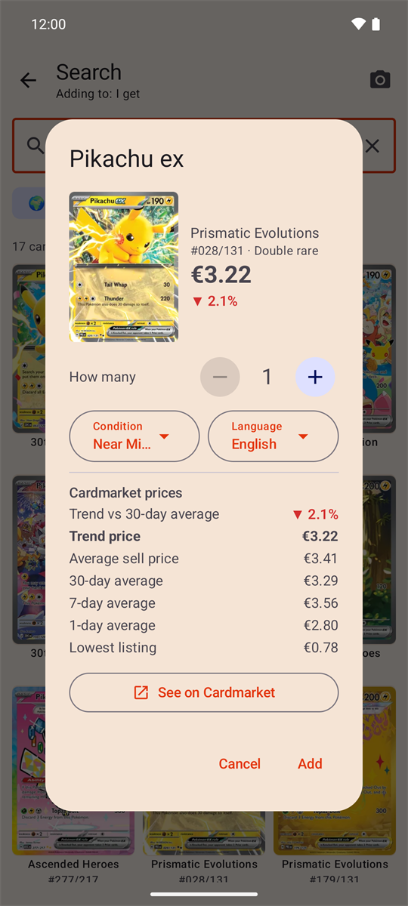
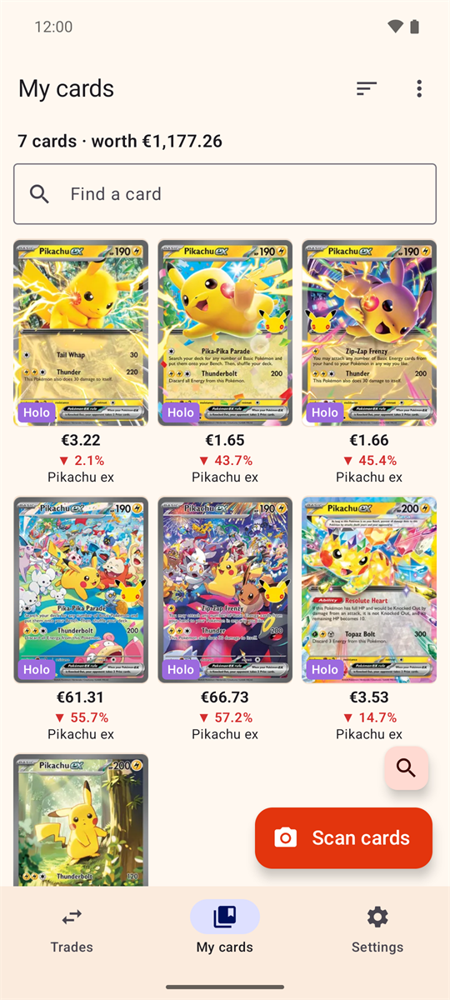
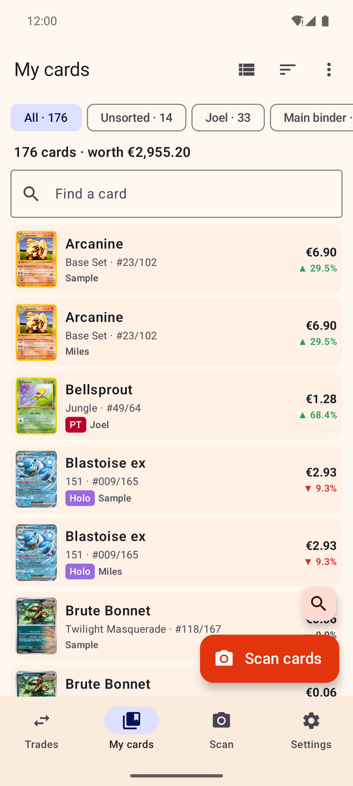
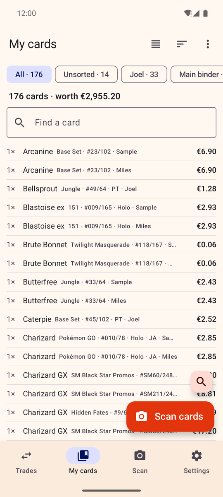

# Poké Trader (Android)

A kid-friendly app for trading Pokémon cards: scan or search the cards on each side, see at a glance whether the
trade is fair (Cardmarket prices, €), and keep the collection up to date when the trade is done.

| Trade | Search | Card | Collection |
|:---:|:---:|:---:|:---:|
|  |  |  |  |

| Collection: list | Collection: compact |
|:---:|:---:|
|  |  |

## Install
[](https://apps.obtainium.imranr.dev/redirect?r=obtainium://add/https://github.com/joelvdc/PokemonTCG-trading-tracker)

**With Obtainium (recommended):** [Obtainium](https://github.com/ImranR98/Obtainium) installs the app straight from
this page's releases and tells you when there's a new version. Tap the badge above on the phone (or add
`https://github.com/joelvdc/PokemonTCG-trading-tracker` in Obtainium by hand). When it asks which file to install,
pick `PokeTrader-<version>.apk`, or the `-universal` one if that won't install.

**By hand:** download `PokeTrader-1.20.apk` from the [latest release](https://github.com/joelvdc/PokemonTCG-trading-tracker/releases/latest),
open it on the phone and allow "install unknown apps" for your browser or file manager when asked. It's built for
64-bit ARM phones (practically every phone from the last ~6 years). If it refuses to install, use
`PokeTrader-1.20-universal.apk` instead (bigger, runs on any device). Updates install over the old version and keep
your cards.

## Binders
The collection can be split into binders: the bar above the cards shows **All**, **Unsorted** (cards in no binder) and each
binder with its card count. From the ⋮ menu you can create, rename, delete and **merge** binders (e.g. a "new cards"
binder into your main one; identical cards are combined). Tap a card to move it, or some of its copies, to another
binder. "We traded!" asks which binder the new cards go into (or makes a new one); cards you give are taken from
Unsorted first. The CSV backup keeps each card's binder. Card tiles show the price of one card, with the total for a
stack underneath ("×4 · €80.00"), and "Most valuable" sorts by that single-card price.

**Arrange binders:** ⋮ → **Arrange binders…** lists Unsorted, the Wishlist and every binder; move each up or down with
its arrows. The bar above the collection and the binder lists ("Move to", "Put it in"…) follow that order; **All**
always comes first and new binders go at the end. The order is synced to your other phone.

**Selecting cards:** press and hold a card (in any view, or ⋮ → **Select cards**), then tap more; **Select all shown**
picks every card the search and filters show. The bar at the top shows how many cards and their value, with
**Move to binder…**, **Add to a trade** (on the "I give" side of an open trade or a new one), **Delete** (asks first and
makes a restore point) and, under ⋮, **Edit condition, language, price…** (only what you change is changed; stacks
that become the same are combined), **Share as a list**, **Copy as a list** and **Export as CSV**. Every action can be
undone right after.

**Swiping cards** (list and compact views): **swipe right = Move to binder…**, **swipe left = Add to a trade…** by
default; for a stack of several copies, the window asks how many. Settings → **Swiping cards in the collection** sets
each direction to: move to binder, add to a trade, one copy more, one copy less, add to the wishlist, or nothing.
Every swipe can be undone.

The collection can be shown as **cards** (big pictures, the default), a **list** (small picture, set and number, tags and
price) or **compact** (one text line per card); pick it with the view button next to Sort.

**Sort** works in layers: e.g. rarest first, then by name, then by set. Each layer can be reversed, there are ready-made
choices (name, set and number, rarest, most valuable, newest, rising lately, falling lately), and the app remembers
your sort. **Change in %** and **Change in money** sort by how the price moved lately, biggest rise or biggest fall
first: Cardmarket's trend price against its 30-day average for one card (also while TCGplayer is your price source);
cards without a 30-day average go last. **Filter** narrows the
cards by set, rarity, version (holo, reverse holo…), international or Japanese print, condition, language and price;
active filters show as chips under the search field, tap one's ✕ to drop it.

**The card page** (tap a card) is compact: picture, price and trend on top; **Printing** (another set or number),
**Other card** (if the scanner picked the wrong one) and **Cardmarket** buttons; then quantity, version, binder,
condition, language, **what you paid** and **notes**, two to a row. Underneath, **"You also own…"** lists every other
copy of the card with the same name (same card first, then by value; tap one to open it), and Cardmarket's prices fold
into one line (tap for all). Save only lights up once something has changed. Notes and purchase price are kept in the
CSV backup.

**Prices in the currency you paid in** (since 1.20): every price field (what you paid, an agreed price in a trade, a
wishlist card's alert level) has a small **€ ▾ / kr. ▾ / $ ▾** button. Type the amount as you paid it; the field says
what it comes to in the currency the app shows ("≈ €20.00"). The price is **kept in that currency**: 300 kr. stays
300 kr. whatever the exchange rate does; totals (Paid and worth, stats) count it at today's rate. Picking another
currency for an amount already there converts it, and back again gives exactly the same amount. A new price field
starts on the currency you chose last. When cards join a stack (moving, merging binders, editing) whose price is in
another currency, the app asks which currency the stack keeps; the stack gets the average paid, weighted by copies.
The CSV backup has a "Purchase currency" column (older files are read as euros).

**Value over time:** tap the total above the cards (or ⋮ → Value over time). The app saves the collection's value once
a day, so the chart fills in as days go by. Underneath: **Paid and worth** (what you paid for the cards that have a
purchase price against what they're worth now, with your best and worst buys), then the cards rising and falling most
lately, per card (one copy, the same change the collection can be sorted by); tap one to open it. The chips at the top
switch between all cards, Unsorted and each binder (binder values are saved from version 1.14 on).

**Collection stats:** the pie-chart button next to the total (or ⋮ → Collection stats). For all cards or one binder,
counted by cards or by value: totals (and what you paid against what those cards are worth now), rarity (rarest
first), **set completion** (how many of a set's official numbers you own, plus secret rares beyond them), era (the
TCGdex series: Base, Scarlet & Violet, Mega Evolution…), special Pokémon (ex, V, VMAX, GX, Mega, Radiant… read from
the names), the Pokémon you have most of (Pikachu ex counts as Pikachu), price of one card, top sets, version, print,
language, condition, binders, cards added per month and the most valuable cards. Tap a line to see those cards in
the collection, or a valuable card to open it.

Add cards with the big **+ Add card** button (search by name) or the camera button above it (scanner).

## Trades side by side
The button at the top of a trade switches between the two sides one above the other and **side by side** (give on the
left, get on the right, like the cards on the table). The app remembers your choice.

## Wishlist
The **★ Wishlist** in the binder bar holds the cards you want: pick it, then scan or search them. Any version of the card
counts unless you limit it to one (e.g. only the reverse holo). Each card shows whether you have it, and cards on the
wishlist show "★ on your wishlist" on the "I get" side of a trade. The wishlist can be shared as a list (ordered and
received cards are left out) and isn't counted in the collection's value.

**Sections** (since 1.20): **To buy**, **Ordered** and **Received**, each with its card count; tap a section's header to
fold it (Received starts folded). With "Ordered cards in their own section" off (the view menu) it's one list with the
ordered cards last, and Received below.

**Swiping right moves a card one step on:** **To buy → Ordered → Received → the collection.** Tick the "Ordered" box on a
card (or in its window) once you've bought it. A received card stays in Received with the date, as a record: it no longer
counts as wanted (no ★ in trades, no price alerts). Swiped right in Received, it goes into the collection: a window asks
the version, condition, language, copies, binder and what you paid. **Swipe left** to delete. Every swipe can be undone.
The ⋮ menu has **Mark all ordered cards as received**, **Mark the cards I now own as received** (cards you got more copies
of since adding them; shown in a list first) and **Clear received cards**. Settings → **Received wishlist cards** clears
them by themselves after 1, 3, 6 or 12 months, and can add received cards to Unsorted right away. Press and hold to
select several (Ordered, Received, Delete, Back on the wishlist…).

**Price alerts** (since 1.20): open a wishlist card and fill in "Notify me at or below" (in any currency; it keeps the
currency you typed). When the card costs that much or less you get one notification; tapping it opens the card. A new one
only comes after the price has been above your level again, or when you change the level. "Any version" cards are
compared at their cheapest version. Prices are checked after each price update (when the app opens, and every few hours
in the background, so "Update automatically" must be on); Android 13 and later ask once whether Poké Trader may send
notifications. Settings → **Wishlist price alerts** chooses Cardmarket's price for alerts: lowest listing (the default),
trend, or an average. The wishlist shows each card's level under it ("🔔 €0.67 ✓" once reached). Each phone checks and
notifies by itself.

**Offline:** without internet, "Add card" on the wishlist suggests names from Cardmarket's card list saved on the phone
(English names, with the card's attacks). The card goes on the wishlist as "any version", marked "details follow when
you're online"; its set, number and picture are filled in once the phone is back online.

## Sync between phones
Settings → **Sync with Nextcloud** (since 1.20) keeps the collection, binders, wishlist, trades, scans and settings the
same on your phones, using a file (`sync.json.gz`) in a folder of your own [Nextcloud](https://nextcloud.com/). Prices
and pictures aren't synced; each phone downloads those itself.
- **Connect:** enter your server address and log in in the browser; the app gets its own app password, which you can
  revoke in Nextcloud (Settings → Security). An app password made by hand works too. Disconnecting removes the app's
  app password and leaves your data where it is.
- **Folder:** after logging in you pick the folder for the sync file: browse your Nextcloud folders, make a new one, or
  keep the usual "Poké Trader". Pick the same folder on both phones, and not MTG Trader's. Settings → Folder →
  **Change** moves syncing to another folder (the old file stays where it was).
- **First sync:** if both the phone and Nextcloud already hold data, you choose: merge both, use the Nextcloud copy, or
  start from this phone. A restore point is made first.
- **After that** changes are merged item by item: the most recent change to a card stack, binder, trade, scan or wishlist
  card wins, and deletions carry over. With **Sync automatically** on, it syncs when you open the app, about 30 seconds
  after a change, when you leave the app and every hour; **Only on Wi-Fi** keeps automatic syncs off mobile data.
  "Sync now" always works.

The password is stored encrypted with a key kept in the phone's keystore.

## Backups and restore points
Settings → **Backups** (since 1.20) keeps restore points of everything the app syncs (collection, binders, trades, scans,
wishlist and settings).
- They're made **every day** when something changed, and before big changes: the first Nextcloud sync, CSV imports,
  deleting selected cards and restoring a backup. **Back up now** makes one you keep until you delete it.
- With Nextcloud sync they go to a **Backups** folder next to the sync file, where both phones can use them; otherwise
  they're kept on the phone, in the app's storage or (better, as they survive uninstalling) a folder you choose.
  **Save to a file…** and **Restore from a file…** work with any file you keep elsewhere.
- Kept: the latest 10 automatic backups and one per week for 8 weeks.
- **Restoring** shows what differs from now, makes a backup of the current state first and then replaces the app's
  data. Your other phone gets the restored data through Nextcloud.

## Appearance
Settings → **Appearance**: same as the phone, light or dark.

## Scan tab
Scan a pile of cards (or add them by name) into a waiting list, then select some or all of them and send them **to a
binder** or **to a trade**, or **discard** them.

While scanning, every card that's added shows up in a list under the camera with its price, the newest on top (the list
jumps back to it each time a card is added): **+** adds another copy,
the undo arrow takes it back, and tapping it lets you change the version, condition, language and **number of copies**.
Prices follow the price type chosen in Settings. Every card window has **Other printing…**, which shows all printings
of the card (other sets, promos, numbers) as pictures to pick from.
Turn **Auto-add** off to confirm each recognised card with an "Add" button first.

**✨ Holo:** with "Let the camera tell" (the default) the scanner looks at how the card shines when a card comes both
with and without foil: a glittering text box means reverse holo, artwork that flickers as the card moves means holo. It
says so on the card ("Looks like a reverse holo · tap if not"); tap to pick another version. "Not holo" and "Holo or
reverse holo" set it by hand, as before.

## Where the data comes from (no app updates needed for new sets)
- **Cards, pictures, names in all languages:** [TCGdex](https://tcgdex.net) (free, open API), looked up live.
  International prints use TCGdex's English data (French/German/… prints share numbers and Cardmarket products);
  Japanese prints are separate sets with their own ids and Cardmarket products. Korean and Chinese prints share the
  Japanese sets' codes and numbers, so they're looked up there too.
- **Japanese cards TCGdex is missing:** TCGdex lists many Japanese sets with no or only some cards (e.g. Pokémon GO
  S10b, Eevee Heroes S6a, Shiny Treasure ex SV4a). For those the app reads the card's page on
  [Limitless TCG](https://limitlesstcg.com): Japanese name, picture, and the matching international printing, whose
  Cardmarket product gives the price (the cheapest international print, so not a full art). The card page says when
  a card comes from Limitless; its price is the international print's, which can differ from the Japanese one. Pages
  are kept on the phone for a month. Cards found in neither (e.g. Trading Card Game Classic, "CLV") can't be added.
- **Prices:** Cardmarket's public daily Pokémon price guide (`price_guide_6.json`, ~15 MB), downloaded once a day.
  Each card *variant* (normal, reverse holo, Poké Ball / Master Ball pattern, stamped…) has its own Cardmarket
  product id in TCGdex; reverse holos use the guide's "holo" price columns.
- **TCGplayer** (since 1.16): TCGplayer's market prices in US dollars come with TCGdex's card data (refreshed daily for
  the cards you have, one card at a time, with a progress bar above the tabs; a failed try waits a few hours before the
  next; and whenever TCGdex sends a card). Settings → **Price source** picks Cardmarket
  or TCGplayer to value your cards (collection total, sorting, filters, trades). TCGplayer has one price per version, for
  English prints: normal, holo, reverse holo and 1st edition. Stamped, special-pattern, other-print and jumbo versions
  and Japanese prints keep Cardmarket's price, shown with "≈". The value screen (with a chart per source from 1.16 on),
  the stats ("Value by price source", "Europe or the US?") and each card's page compare both. Kept on the phone only.
- **Currency:** prices are in euros (Cardmarket's). Settings → **Currency** shows them in Danish kroner or US dollars
  instead, converted with the [European Central Bank's daily rates](https://www.ecb.europa.eu/stats/policy_and_exchange_rates/euro_reference_exchange_rates/html/index.en.html)
  (downloaded twice a day at most, kept for offline use). Purchase and agreed prices you type are in that currency too;
  the app keeps them in euros, which is also what CSV files get. The value-over-time chart is converted at today's rate.
- **Checking TCGdex's Cardmarket links:** Cardmarket's public list of Pokémon singles (`products_singles_6.json`,
  ~14 MB, weekly) names every product with its attacks, e.g. "Erika's Bellsprout [Careless Tackle]". The app uses it
  to fill in cards TCGdex doesn't link, and to replace links that point to another card (Gym Heroes' "Erika's …"
  cards → "Erika", Hidden Fates' Charizard GX 9/68 → the shiny one). A link is only replaced when a product with the
  same name and a matching attack is found in the card's set. Plain versions without their own link use the link
  TCGdex has for the card as a whole. Stamped versions are separate products on Cardmarket, except for cards that only
  exist stamped (e.g. the Wizards promos handed out with the first movie, "1st Movie" / "1st Movie inverted" stamp):
  those use the card's one Cardmarket product. Japanese cards (Japanese names) can't be matched this way.
- **Updates:** automatic by default (on opening the app and in the background); Settings can turn them off or limit
  them to Wi-Fi. "Update now" always runs.
- **Pokémon TCG Pocket** (the phone game) cards are in TCGdex too; they're filtered out everywhere since they don't
  exist on paper.

## Known limits
- 1st Edition and Shadowless vintage cards share one Cardmarket product, so 1st Edition can be under-priced — the app
  warns and offers an "agreed price".
- Card pictures come from TCGdex. For international cards TCGdex has no picture for (some promos and special
  collections), the app falls back to pokemontcg.io's image servers (images.pokemontcg.io, and images.scrydex.com for sets from
  2026 on, as its set list says), matching sets via pokemontcg.io's set list on
  GitHub. As a last resort it uses TCGplayer's product picture (TCGdex lists a TCGplayer product id for most
  international and some Japanese cards; the id lookup is cached on the phone). Cards with no picture in any of
  these (still many Japanese ones) show name + number + "no picture".
- Search: type a name, optionally followed by the card number ("pikachu 86", "pikachu 86/110", "charizard TG05").
- Price arrows compare Cardmarket's trend price with its 30-day average (▲/▼ with one decimal, ▬ 0.0% when equal);
  cards without a 30-day average (e.g. brand-new printings) show no arrow. Removing a card or deleting a trade can be undone.
- Oversized (jumbo) cards are a version of the normal card ("Jumbo · Holo"), with their own Cardmarket price. The
  camera can't tell size, so a scanned card is added as standard size with a "Big card? Tap it" hint when a jumbo
  version exists. Jumbo cards TCGdex doesn't list can't be added.
- The scanner identifies cards mainly by the printed number ("025/165") plus the name. Holo vs reverse holo can't be
  seen by the camera: use the "✨ Holo" toggle or tap a scanned card to change its version.
- ex, V, VMAX, VSTAR and GX cards are recognised from the rule box at the bottom ("Pokémon ex rule"), since the
  stylised logo next to the name is often misread. A card is only added from its number alone when the printed set
  code confirms the set; otherwise the scanner shows pictures to pick from.
- The camera can't read Korean (Hangul) text: Korean cards are found by their set code and number ("S6a 015/069",
  "M2a 015/193").
- 30th Celebration (2026): TCGdex doesn't link these cards to Cardmarket yet, and Cardmarket lists them in several
  look-alike expansions, so they show no price until TCGdex adds the links (the app doesn't guess between them).

## Rebuilding
Same toolchain as the MTG Trader app next door: JDK 17+ and the Android SDK at `%USERPROFILE%\Android\sdk`.
```
set JAVA_HOME=C:\Program Files\Java\jdk-18.0.2
gradlew assembleRelease
```
APKs land in `%LOCALAPPDATA%\poketrader-build\app\outputs\apk\release\` (kept out of OneDrive on purpose).
Bump `versionCode`/`versionName` in `app/build.gradle.kts` for each new release.

**Keep `keystore/` and `keystore.properties` safe and private** (they're git-ignored). Android only installs an update
over the existing app if it's signed with the same key; losing it means uninstalling (and losing the app's data).

Tests: `gradlew testDebugUnitTest` (logic, parser, variants) and `gradlew connectedDebugAndroidTest` (real OCR on six
card images in `app/src/androidTest/assets`, needs a device/emulator with internet; plus editing scanned cards against
an in-memory database).

## Screenshot tests
`app/src/test/java/com/poketrader/ScreenshotTest.kt` draws screens with sample cards on the computer (Robolectric and
Roborazzi, no phone or emulator) and compares them with the pictures in `app/src/test/screenshots`. Every pull request
runs the comparison; when a screen looks different, the new picture and a picture of the differences are attached to
the failed run ("screenshot-differences").
```
gradlew verifyRoborazziDebug   (compare the screens with the pictures)
gradlew recordRoborazziDebug   (redraw the pictures after an intended change, then commit them)
```

## Code map
- `data/Tcgdex.kt` – TCGdex client, variant naming, card → printings.
- `data/SetCatalog.kt` – cached set lists (for "/165 → which set?"), Pocket filter, eras for the stats.
- `data/CollectionStats.kt` – the numbers behind the stats screen (`ui/StatsScreen.kt`).
- `data/PriceGuideRepository.kt` – Cardmarket price guide download/import.
- `data/Repository.kt` – trades, collection, apply/undo, CSV.
- `data/Sync*.kt`, `data/Nextcloud.kt`, `data/Backups.kt` – sync between phones and restore points (as in MTG Trader).
- `data/PriceAlerts.kt` – wishlist price alerts; `data/PurchasePrices.kt` – stacks' average paid and its currency.
- `scan/CardTextParser.kt` – reads name / number / set code / language from OCR lines.
- `scan/CardRecognizer.kt` – turns those clues into a card (or a "which one is it?" choice).
- `ui/` – Compose screens.

## License and disclaimer
The code is released under the [MIT License](LICENSE). That covers this app's code only, not the card data, names or
pictures it shows.

Poké Trader is an unofficial fan project. It isn't affiliated with, endorsed or sponsored by Nintendo, Creatures,
GAME FREAK or The Pokémon Company; Pokémon and the card names and pictures are their trademarks and property.
It also isn't affiliated with TCGdex, Cardmarket, pokemontcg.io or TCGplayer; it uses their public data. Prices are for
guidance only.
